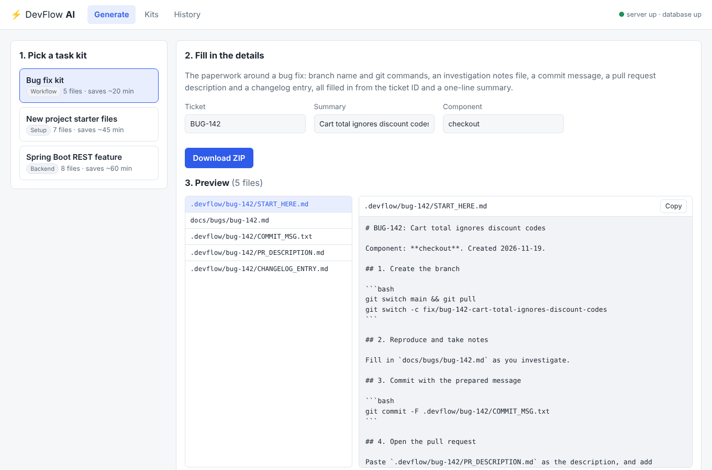

# DevFlow AI

**Stop hand-writing the same files for every task.** DevFlow AI is a small, self-hosted developer
productivity platform. You pick a *task kit* (for example, "add a REST feature" or "fix a bug"),
type a few values such as `order item` once, and it generates every file the task needs, ready
to drop into your project as a ZIP. Each file gets the value in the right naming style:
`OrderItem`, `orderItem`, `order-item`, `order_items`, and so on.

Setting up a new Spring Boot CRUD feature by hand (entity, repository, service, controller,
DTO, migration, test, docs) typically takes about an hour. With the built-in kit it takes under
a minute.



## Features

- **Generate**: pick a kit, fill in a short form, check a live preview of every file, and download a ZIP.
- **Built-in kits** (read-only, refreshed on every start):
  - *Spring Boot REST feature*: entity, repository, service, controller, request DTO, Flyway migration, unit test and feature notes (about 60 minutes saved)
  - *Bug fix kit*: branch commands, investigation notes, commit message, PR description and changelog entry (about 20 minutes)
  - *New project starter files*: README, .gitignore, .editorconfig, .env.example, CONTRIBUTING, PR template and GitHub Actions CI (about 45 minutes)
- **Your own kits**: create and edit kits in the browser. Placeholders become form fields automatically.
  Duplicate a built-in kit to customize it. Export or import kits as JSON to share them with your team.
- **History**: every download is recorded in PostgreSQL, with an estimate of the total time saved.
- **Safety**: generated paths cannot escape the target folder (zip-slip protection), inputs are
  validated, and all secrets come from environment variables.

## Tech stack

| Part | Choice | Why |
|------|--------|-----|
| Language | Java 21 | Current long-term-support (LTS) Java release |
| Framework | Spring Boot 4.0 | REST API, validation and database access with little boilerplate |
| Database | PostgreSQL 16 | Stores kits and history |
| Migrations | Flyway | The schema is versioned in `src/main/resources/db/migration` |
| Frontend | Plain HTML, CSS and JS in `src/main/resources/static` | No Node.js or build step; Spring serves it |
| Tests | JUnit 5, MockMvc, H2 | `mvn test` needs no running database |

## Quick start

### 1. Install the prerequisites

- **Java 21** (for example, [Eclipse Temurin](https://adoptium.net/)). Check with `java -version`.
- **PostgreSQL 16**: either Docker Desktop (easiest) or a normal PostgreSQL installation.
- You do **not** need to install Maven: the project includes the Maven Wrapper (`mvnw` / `mvnw.cmd`).

### 2. Configure

```bash
cp .env.example .env
```

Open `.env` and replace both `change-me…` passwords with the **same** long random value.
`.env` is in `.gitignore`, so your password is never committed.

### 3. Start the database

With Docker:

```bash
docker compose up -d
```

Or, with PostgreSQL installed locally, create the user and database once, using the password from your `.env`:

```bash
psql -U postgres -c "CREATE USER devflow WITH PASSWORD 'your-password-from-.env';"
psql -U postgres -c "CREATE DATABASE devflow OWNER devflow;"
```

### 4. Run the app

```bash
./mvnw spring-boot:run
```

On Windows, use `mvnw.cmd spring-boot:run`.

Then open **http://localhost:8080**. On the first start, Flyway creates the tables and the three built-in kits are loaded.

To build a single runnable JAR instead:

```bash
./mvnw package
java -jar target/dev-productivity-platform-0.1.0.jar
```

Run the JAR from the project folder so it finds your `.env`, or set the variables in your shell.

### 5. Run the tests

```bash
./mvnw test
```

## Configuration

All settings can come from environment variables or from `.env`:

| Variable | Default | Meaning |
|----------|---------|---------|
| `DB_URL` | `jdbc:postgresql://localhost:5432/devflow` | JDBC URL of the database |
| `DB_USERNAME` | `devflow` | Database user |
| `DB_PASSWORD` | *(empty)* | Database password (**required**) |
| `PORT` | `8080` | Web server port |
| `SERVER_ADDRESS` | `127.0.0.1` | Which network interface to listen on. The default allows access from this machine only. |

## Writing your own kit

In the **Kits** tab, click **New kit** and add files. Paths and contents can contain placeholders:

| You write | With input `order item` you get |
|-----------|--------------------------------|
| `{{entity}}` | `order item` (as typed) |
| `{{entity\|pascal}}` | `OrderItem` |
| `{{entity\|camel}}` | `orderItem` |
| `{{entity\|kebab}}` | `order-item` |
| `{{entity\|snake}}` | `order_item` |
| `{{entity\|constant}}` | `ORDER_ITEM` |
| `{{entity\|title}}` | `Order Item` |
| `{{entity\|plural\|snake}}` | `order_items` (filters apply left to right) |
| `{{entity\|lower}}`, `{{entity\|upper}}` | lower or upper case |
| `{{pkg\|path}}` with `com.acme.shop` | `com/acme/shop` |
| `{{today}}`, `{{year}}` | today's date and the year (no form field) |

Anything that is not exactly `{{name}}` or `{{name|filter}}` is left alone, so GitHub Actions
expressions such as `${{ secrets.TOKEN }}` pass through unchanged.

Built-in kits live in `src/main/resources/seed-kits/*.yml`. To add a kit that ships with the app,
add a YAML file there and restart.

## REST API

The UI uses this API, and you can call it from scripts too:

| Method | Path | Purpose |
|--------|------|---------|
| GET | `/api/kits` | List kits with their variables |
| GET | `/api/kits/{id}` | One kit with all its files |
| POST | `/api/kits` | Create (or import) a kit |
| PUT | `/api/kits/{id}` | Update a custom kit |
| DELETE | `/api/kits/{id}` | Delete a custom kit |
| POST | `/api/kits/{id}/duplicate` | Copy a kit, including built-in ones |
| GET | `/api/kits/{id}/export` | Download a kit as JSON |
| POST | `/api/kits/{id}/preview` | Render the files as JSON (records nothing) |
| POST | `/api/kits/{id}/generate` | Render the files as a ZIP and record history |
| GET | `/api/runs`, `/api/stats` | History and totals |
| GET | `/actuator/health` | Server and database health |

Example: generate the bug fix kit from the command line and unzip it into your repository:

```bash
curl -s -X POST localhost:8080/api/kits/1/generate \
  -H 'Content-Type: application/json' \
  -d '{"variables":{"ticket":"BUG-142","summary":"Cart total ignores discount codes","component":"checkout"}}' \
  -o kit.zip && unzip -o kit.zip -d ~/my-project
```

Kit IDs come from `GET /api/kits`.

## Project layout

```
src/main/java/com/devflow/
  DevFlowApplication.java   entry point (in the root package so Spring finds every controller)
  kit/        kits: entity, repository, service, REST controller, YAML seeder
  generate/   template engine, case conversion, preview/ZIP generation
  history/    generation history and stats
  web/        API error types and the JSON error handler
src/main/resources/
  application.yml           configuration (no secrets)
  db/migration/             Flyway SQL migrations
  seed-kits/                built-in kits (YAML)
  static/                   the web UI
```

## Assumptions and decisions

The original project files were not available, so the project was rebuilt from the earlier description.

- **Purpose**: "automate repetitive developer work, including preparing the assets and files
  needed for a task" is implemented as template-based task kits with a live preview and ZIP download.
- **Package**: `com.devflow`. The main class sits at the package root, so component scanning
  covers every subpackage. Earlier there was a concern that `HealthController` was outside the scan path.
  Health checks now use Spring Boot Actuator (`/actuator/health`), which also checks the database.
- **Java 21 and Spring Boot 4.0**: the brief asked for Java 21. Spring Boot 3.5's free support ended in mid-2026, so 4.0 is used.
- **No login**: this is a local, single-user developer tool, so by default it listens on `127.0.0.1` only.
  Add authentication (for example, Spring Security) before exposing it on a network.
- **"AI"**: no AI model or API key is used yet. Kits are deterministic templates.
  Possible next steps: AI-suggested kits, or AI filling in placeholders such as summaries.
